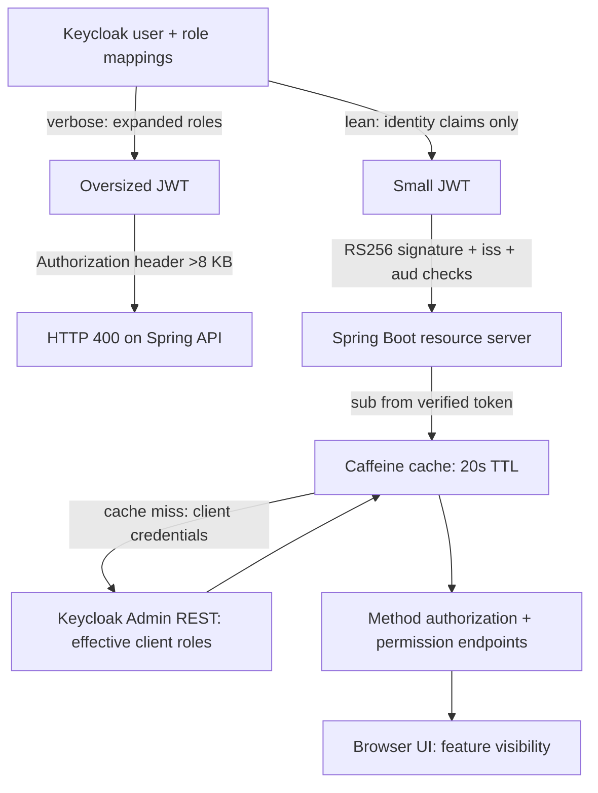

# Keycloak oversized JWT: reproduction and solution

A **Spring Boot 3.5.16 / Java 21** + **Keycloak 26.8.2** Docker Compose demo of large JWTs caused by composite roles. It provides a lean-JWT alternative with effective-permission lookup and backend authorization.

**Development only.** All passwords are fixed and known, Keycloak runs in `start-dev` mode, and password grants are enabled for the CLI comparison. Browser login uses Authorization Code + PKCE.

## Quick start

Requirements: Docker Engine with Compose v2, Python 3 on the host, ports 8080 and 8081 free.

```bash
docker compose up --build -d
docker compose logs -f seed      # wait for "Demo ready"
python3 scripts/compare.py
```

Open **http://localhost:8081/** and use the demo credentials **trader / trader**. Sign in using **lean JWT** to see permission-aware buttons. Choose **oversized JWT** to see the failing HTTP request.

Keycloak Admin Console: **http://localhost:8080/admin/** (`admin / admin`). Realm: `large-jwt-demo`.

Reset everything, including the realm:

```bash
docker compose down -v
```

## What is reproduced?

Keycloak client `permission-catalog` has 450 synthetic permission roles plus a small set of realistic ones:

- `orders:read`
- `orders:cancel`
- `orders:create` (**not granted**)
- `trades:read`
- `reporting:desk:global:dataset:0001:read:instrument-universe` ... through `0450`

The composite client role `trader` contains 453 leaf permissions and is assigned to user `trader`. Keycloak expands the composite into effective client roles.

| Case | `verbose-cli` | `lean-cli` |
|---|---|---|
| `roles` client scope | attached | removed |
| `fullScopeAllowed` | `true` | `false` |
| Access token contains `resource_access.permission-catalog.roles` | yes, ~454 roles including composite | absent |
| JWT size | many kilobytes (greater than 8 KB) | small |
| `GET /api/me/permissions?prefix=orders:` | Tomcat rejects large HTTP header (`400`) | `200` |
| Backend authorization | blocked by oversized header | resolved using Keycloak Admin REST + Caffeine |

The API sets `server.max-http-request-header-size=8KB` to reproduce rejection. The script **measures actual token sizes** and asserts the expected statuses; the values depend on Keycloak's generated JWT claims.

## Architecture



### Security boundaries

- Both clients include `aud=demo-api` through an audience protocol mapper. Spring checks **JWT signature, expiry, issuer, and audience**.
- The backend never trusts a username, subject, or permission list from the browser. It uses `sub` from the verified JWT.
- The backend obtains **read-only** Keycloak Admin API access through `authz-svc` client credentials. Roles: `realm-management:view-users` and `realm-management:view-clients`.
- The client role-mappings Admin REST endpoint resolves the user's effective client roles, including composites and group mappings. The backend does not consume JWT role claims for authorization.
- UI permissions are for **presentation only**. Backend endpoints use `@PreAuthorize` with the same `PermissionService`.
- Authorization lookup failures **fail closed** with `503` on uncached requests. A cached grant can remain in effect for at most the configured TTL after a role change (subject to the local cache's expiration timing). Cache is local per API process.
- The demo excludes the parent `trader` composite role from its returned permission list. Real deployments should define explicit permission namespaces and filter accordingly.

## API examples

Get a lean access token using Python (demo-only password grant):

```bash
TOKEN=$(python3 - <<'PY'
from urllib.parse import urlencode
from urllib.request import Request, urlopen
import json
url = 'http://localhost:8080/realms/large-jwt-demo/protocol/openid-connect/token'
body = urlencode({'grant_type': 'password', 'client_id': 'lean-cli', 'username': 'trader', 'password': 'trader'})
req = Request(url, data=body.encode(), headers={'Content-Type': 'application/x-www-form-urlencoded'})
print(json.load(urlopen(req))['access_token'])
PY
)

curl -sS -H "Authorization: Bearer $TOKEN" \
  'http://localhost:8081/api/me/permissions?prefix=orders:'

curl -sS -H "Authorization: Bearer $TOKEN" -H 'Content-Type: application/json' \
  -d '{"permissions":["orders:cancel","orders:create"]}' \
  http://localhost:8081/api/me/permissions/check

curl -i -X POST -H "Authorization: Bearer $TOKEN" \
  http://localhost:8081/api/orders/cancel  # 200

curl -i -X POST -H "Authorization: Bearer $TOKEN" \
  http://localhost:8081/api/orders         # 403
```

Permission response (selected subset):

```json
{"subject":"<authenticated-keycloak-sub>","count":2,"permissions":["orders:cancel","orders:read"]}
```

The `POST /api/me/permissions/check` endpoint accepts up to 100 permission strings per call. It evaluates them against **one cached effective role set**, avoiding transferring 450 permissions to the frontend.

## Demonstrate revocation and stale cache

1. Sign in using lean JWT; fetch `orders:cancel` once to populate the cache.
2. Execute `python3 scripts/change_permission.py revoke`.
3. Immediately try to cancel: it can still return `200` while the cache is warm.
4. **After 20+ seconds**, call `POST /api/orders/cancel` again with the **same unexpired JWT**; it must now return `403`. The frontend can refresh the permission endpoint to disable the button.
5. Execute `python3 scripts/change_permission.py restore`; authorization becomes effective after cache expiry.

This demonstrates the cache's consistency window and the fact that token reissuance is not required to observe a permission change. The CLI token lifetime is 15 minutes.

## Operational and production considerations

The demo deliberately uses **Keycloak Admin REST per cache miss** for a clear implementation. Production alternatives include synchronizing role/group mappings to an application-side permission graph and maintaining it with Keycloak events plus reconciliation.

- **Staleness and revocation:** A 20-second TTL is an explicit consistency trade-off. For immediate revocation, add authenticated invalidation events, version checks, or server-side authorization where necessary.
- **Performance:** Client composite mapping lookups can still be expensive for large data sets. Measure P50/P99 on your specific realm, including group hierarchy. Prefer a precomputed permission projection for high request rates.
- **Security:** Limit the service account's admin permissions using Keycloak fine-grained admin permissions where feasible. Keep it separate from the public client. Never expose the admin service secret or Keycloak Admin REST to the browser. Restrict client audiences, configure a real reverse proxy and TLS, and disable password grants.
- **Multi-instance deployment:** Caffeine is local to one JVM. Production requires cross-instance invalidation or an appropriate distributed cache with defined staleness guarantees.
- **Frontend:** Prefer batch `check` for page-specific capabilities and refresh them on navigation or after authorization errors. Never rely on disabled buttons to enforce access.
- **Keycloak built-in features:** The demo uses standard OIDC protocol mappers and the Admin REST API. Lightweight access tokens and Authorization Services are other options; evaluate them based on client and resource-server requirements.

## Source layout

```text
compose.yaml                         # Keycloak, idempotent realm seed, Spring Boot API
seed/seed.py                        # user, clients, roles, service account, audience mapper
src/main/java/dev/demo/authz/       # JWT verification, cached role lookup, endpoints
src/main/resources/static/index.html # Browser authorization-code PKCE demo
scripts/compare.py                  # Asserts oversized vs lean JWT and HTTP outcomes
scripts/change_permission.py        # Revoke/restore a permission mapping
src/test/                          # Java unit test
```

### References

- [Keycloak token role mappings](https://www.keycloak.org/docs/latest/server_admin/#_role_scope_mappings)
- [Keycloak Admin REST](https://www.keycloak.org/docs-api/26.8.1/rest-api/)
- [Spring Security OAuth2 resource-server JWT](https://docs.spring.io/spring-security/reference/servlet/oauth2/resource-server/jwt.html)
- [Keycloak client composite-role mapping performance](https://github.com/keycloak/keycloak/issues/51531)

## License

[MIT](LICENSE)
